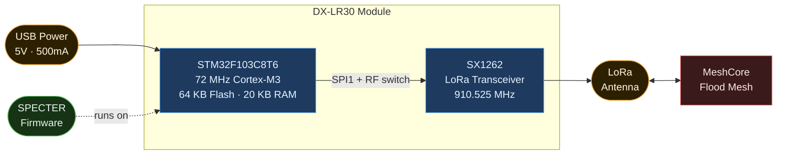
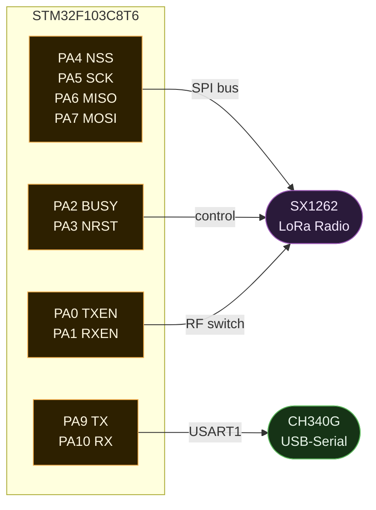
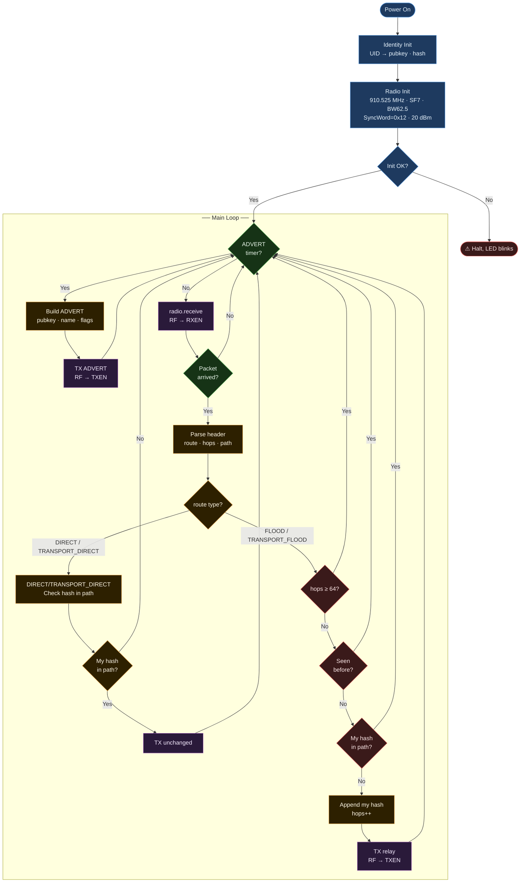
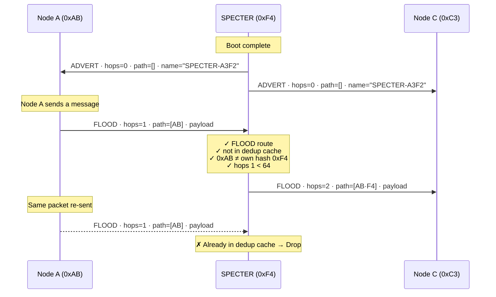
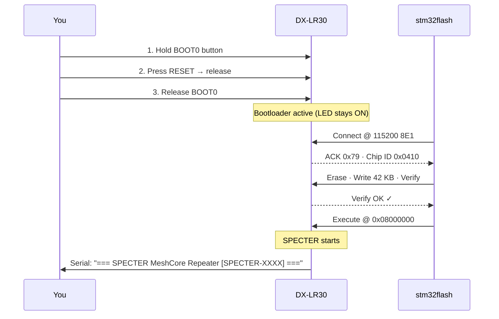

# Spectra-Cascadia: native MeshCore repeater for the DX-LR30

*(CascadiaMesh fork of SPECTER by MaliosDark)*

> The DX-LR30 is a cheap Chinese LoRa shell device. MeshCore has no official
> firmware for STM32F103 + SX1262.

---

## v2.x (CascadiaMesh fork): what changed and why

v1.1 relayed traffic but behaved in ways that hurt a shared regional mesh. v2.0
rewrites the forwarding logic to follow upstream MeshCore
(`src/Mesh.cpp` + `examples/simple_repeater`) as closely as a 20 KB-RAM,
no-filesystem part allows.

| Problem in v1.1 | v2.0 behaviour |
|---|---|
| The 2-minute "local" advert was sent as `FLOOD`, so every repeater relayed it mesh-wide | Zero-hop adverts are `DIRECT` with an empty path (upstream `sendZeroHop`). Flood adverts every 47 h, as upstream |
| `TRANSPORT_*` packets parsed without their 4 transport-code bytes → corrupted on relay | Parsed per `Packet::readFrom`; codes preserved |
| Region scoping ignored | Scoped floods forwarded only for configured regions (same HMAC check as `RegionMap::findMatch`). Own flood adverts can be scoped with `region default` |
| `DIRECT` relayed if our hash appeared *anywhere* in the path, unchanged, no dedup → broken DMs, possible ping-pong | Forwarded only when we are the next hop, self removed from path, deduplicated. ACK / multipart ACK / TRACE handled as upstream |
| Every payload type flooded | Only types upstream floods; adverts signature-verified first; hop limits `flood.max`, `flood.max.unscoped`, `flood.max.advert` (8); loop detection |
| Blind 300–800 ms `delay()` with the radio deaf | Listen-before-talk on SX1262 preamble/header IRQs, randomized `tx_delay_factor` delays, TX queue with RX running, airtime budget |
| Advert timestamp = build time + uptime → goes backwards on every reboot (nodes ignore it as a replay); wraps at 49 days | Flash journal keeps time monotonic across reboots; clock pulled forward to the median of verified neighbour adverts |
| EU frequency hard-coded, preamble 8 | US/Canada preset by default, configurable over serial; preamble 16 as upstream; TCXO/crystal auto-detected |
| Busy-polling at 72 MHz | MCU sleeps (`WFI`) between polls |

v2.1 adds an upstream-style **USB serial CLI** with settings stored in flash (below).
v2.4 adds an **XL build** with login from the normal MeshCore app (below). Still not
included: private (`$`) regions.

**Status (v2.4):** the standard build compiles (≈60 KB of the 62 KB budget) and passes the host-side tests in
`test/host/` (forwarding rules, region codes cross-checked against a Python HMAC
reference, journal wear/rollover, serial CLI, settings persistence). **Not yet RF-tested on hardware.** Test on the bench
next to a known-good MeshCore repeater before deploying.

### v2.4: Spectra-Cascadia, and the XL build (log in from the MeshCore app)

The firmware is now called **Spectra-Cascadia** (`ver` → `Spectra-Cascadia v1.17.1.1`: the official MeshCore version it tracks, plus our release number; new
nodes default to the name `Spectra-XXXX`). Saved names are not changed.

Most STM32F103**C8** chips have 128 KB of flash, although they report 64 KB. The **XL build**
uses the upper 64 KB: RadioLib and the crypto library move up there, which frees
room in the lower 62 KB for the server side of upstream `simple_repeater`:

| From the MeshCore app | XL |
|---|---|
| Log in as admin / guest (password) | ✓ (`ANON_REQ` login, same key exchange and AES/HMAC as upstream) |
| Status screen (battery, uptime, queue, noise floor, RSSI/SNR, packet counts, airtime) | ✓ |
| Telemetry (voltage + MCU temperature, Cayenne LPP) | ✓ |
| Neighbours (zero-hop repeater adverts heard: key, last heard, SNR) | ✓ (last 8) |
| Command line: every USB command, plus `clock sync` (sets time from the phone) | ✓ (admin only) |
| Repeater settings screen (name, radio, power, location, adverts, flood max, delays, duty cycle, owner info, RX gain, interference threshold, AGC reset, …) | ✓ (v2.4.1) |
| Access list, owner info, anonymous clock/owner/regions queries | ✓ |
| Neighbours: 128 kept (upstream 50), `discover.neighbors`, `neighbor.remove` | ✓ (v2.5) |
| Admins stay logged in across reboots; `setperm`, `get acl` (USB) | ✓ (v2.5) |
| `region def`, `region load` (indented import) | ✓ (v2.5) |
| Alerts to a channel (low battery, shutdown, restarts): `set alert.channel #name`, `set alerts on/off`, `alert test` | ✓ (v2.6) |
| `flood.ratelimit`: cap floods per minute from one source | ✓ (v2.6) |
| `tempradio` (try radio settings for N minutes, then revert), `cad on/off`, `rxdelay`, `radio.watchdog`, login attempt limits, `neighbors.detail` (RSSI, times heard) | ✓ (1.17.1.2) |
| `set guest on/off`, `get guests`, `get logins` (recent login attempts); `repeat.battery` / `flood.battery` (pause forwarding on a low battery) | ✓ (1.18.0.2) |
| `radio2`: a second LoRa profile (e.g. MediaMesh) on the same radio, `radio2.cross`, `tx.reply` | ✓ (1.18.0.3) |
| `get/set prv.key`, `erase`, `log` over the air | refused: USB only |

**Login is off until you set a password over USB:**

```
password <admin password>        (max 15 characters; also works over the air)
set guest.password <password>    (optional, read-only access)
set guest on                     (guest logins are off until you turn them on)
get guest.password
```

An empty admin password never matches, and upstream's default `password` is **not** set.
With `guest on` and an empty guest password, anyone can log in as a guest (read-only).
`set guest off` ends guest sessions at once; a guest that logged in earlier can't come
back with a blank password. `get guests [page]` lists live guest sessions (one key per
page) and `get logins [page]` the last 16 keys that tried to log in, newest first, with
the result (`accepted`, `wrong-password`, `guests-disabled`, `replay/state`) and a count.
Both are kept in RAM only.

**Pause forwarding on a low battery** (needs `battery.pin`; without it the node can't see
the battery and never pauses):

```
set flood.battery on             (stop relaying floods below 20 %; or give a percentage)
set repeat.battery on            (stop relaying anything below 10 %; or give a percentage)
get battery.forward              (battery=55% mv=3660 repeat=allowed flood=allowed)
set battery.empty 3000           (mV for 0 %; battery.full for 100 %, default 4200)
```

Relaying resumes 2 points above the threshold. The node's own adverts, replies and alerts
still go out, and `set repeat`, flood limits and `battery.cutoff` work as before.
Remote `reboot` waits about 4 s so its reply can go out first.

**radio2: a second profile on the same radio** (as Halo Keymind Cascade 1.18). The SX1262
alternates between your normal `radio` and a second profile, so the Cheapeater can relay a
MediaMesh side channel (MeshCore Open TAK / Wadamesh TAK photos and voice) as well as the
normal network:

```
set radio2 mediamesh             (911.150 MHz, 250 kHz, SF7, CR5, rx+tx; mediamesh-range = 125 kHz)
set radio2 911.15,250,7,5,rxtx   (any profile: MHz,kHz,SF,CR,rx|rxtx[,preamble])
get radio2                       (warns if radio2 sits within 6 kHz of radio's channel, and suggests a centre)
get radio2.status                (packets per profile, switches, measured switch time, preambles)
get radio2.scan / radio2.timing  (listening windows; recommended preambles)
set radio2 off
```

Packets are relayed on the profile they arrived on. `set radio2.cross on` copies them to the
other profile as well (default `off` keeps the two networks apart). Replies to logins, requests
and discovery go out on both profiles by default; `set tx.reply radio|radio2|auto|off` changes
that (`both force` / `radio2 force` lets replies use an `rx`-only radio2). The node's own adverts
stay on `radio` unless crossing is on.

**It is one radio taking turns, not two.** It listens about 9 ms on the slower profile and
about 19 ms on the faster one, and can't hear either while it is receiving or sending on the
other. Packets will be missed when senders use short preambles. The firmware measures how long
a switch takes and sets its own preambles to match (radio: 32 symbols, MediaMesh: 48), and
`get radio2.timing` says what the *senders* need. Stock MeshCore sends 32 symbols at SF7, which
covers the normal network; MediaMesh senders need about 48. Noise-floor sampling and
`int.thresh` pause while scanning. Changes take effect 2 s after the reply.

**Before flashing XL, run `tools/flash128_test` on that board** (each chip has to pass).
If the upper half is missing or wasn't written, XL stops at boot, prints why on the
serial port and blinks the LED slowly. It doesn't run half-installed.

**Flash the `.hex` file, not a `.bin`.** The image skips the two settings pages at
0x0800F800–0x0800FFFF, so name, identity, regions and passwords survive the upgrade
(and a later downgrade to the standard build). A `.bin` would fill that gap with zeros.
With STM32CubeProgrammer, open the `.hex` and click Download. Don't use Full chip erase.
If the programmer refuses addresses above 0x08010000 (it believes the 64 KB size register),
use `pio run -e specter_xl -t upload`, which runs OpenOCD with the flash size forced to 128 KB.

Layout (`specter_xl.ld`): 0x08000000 core (≈44 KB of 62 KB used) · 0x0800F800 settings ·
0x0800FC00 clock journal · 0x08010000 RadioLib + Crypto (≈26 KB of 63 KB), with a marker
word at the end · 0x0801FC00 saved admin list (not in the image). `tools/xl_hex.py` writes the `.hex` and fails the build if any global
constructor ends up in the upper half, because constructors run before the check.
Host tests (`test/host/test_xl.cpp`) check the key exchange against upstream
MeshCore's own ed25519 code. They also run login, PATH learning, status, telemetry,
neighbours, the access list, remote CLI, the legacy ACK and replay rejection end to end.

### v2.3.1: quieter adverts

Defaults are now **no periodic zero-hop adverts** and **a flood advert every 83 hours**,
following CascadiaMesh's airtime policy. Upgrading a node that still has the old defaults
(2 min / 47 h) switches it to the new ones; values you set yourself are kept. On any version
you can also run `set advert.interval 0` and `set flood.advert.interval 83`. `advert` and
`advert.zerohop` still send one on demand.

### v2.3: power saving, battery telemetry and cutoff, advert echo guard, radio stats

**Power saving.** `powersaving on`, then `reboot`, runs the processor at 16 MHz instead of
64 MHz. The firmware already sleeps between radio polls, and sleeping at 16 MHz draws
roughly a quarter as much (estimated savings: about 8–12 mA; measure your board).
Trade-off: signature checks on adverts take about 4× longer, so a burst of adverts adds a
little latency. `powersaving` shows the current setting. The boot banner prints the active
clock speed.

**Battery voltage.** With no wiring, `get battery` reports the chip's own supply voltage
(VDD). That only tracks the battery when you use a plain LDO regulator, such as the HT7333.
**With a buck-boost** (TPS63020, XL63802), VDD stays at 3.3 V, so add a divider:

```
battery + ──[100k]──┬──[100k]── GND
                    ├── PB0 (or PB1)
                    └──[100 nF]── GND   (optional, steadies the reading)
```
```
set battery.pin pb0
set battery.divider 2.00        (2.00 for two equal resistors)
get battery
```
The divider draws about 20 µA. The board's POW LED and the regulator's LED draw far more,
so remove those LEDs on solar nodes.

**Telemetry history.** Battery voltage and chip temperature are recorded every 30 minutes
for 7 days (cleared on reboot). Use `get telemetry.volt [page]` and
`get telemetry.temp [page]`, 20 samples per page, newest first. The temperature comes from the
STM32's internal sensor, so it's approximate and reads a few degrees warm.

**Low-voltage cutoff.** `set battery.cutoff 3300` (mV; `off` disables it). After three
readings in a row below the cutoff, 30 s apart, the node saves its clock, puts the radio in
cold sleep, and puts the STM32 into standby. It wakes every ~26 s, checks the voltage in a
fraction of a second, and resumes only once the battery is above `battery.resume` (default:
cutoff + 200 mV). Each wake-up is brief, so standby draws very little on average; the LEDs
and the regulator dominate. Suggested values: Li-ion `3300`, LiFePO4 `2900`.

**Advert echo guard.** Once a downstream echo shows an advert this node forwarded got
further, the node won't forward that exact advert again for as long as its signed timestamp
is under 6 hours old, even after the dedup table has forgotten it. `stats` shows the count
as `advguard`.

**Radio stats** (upstream JSON format, so existing tools can parse them):
- `stats-radio`: `noise_floor` (average of idle RSSI samples, as upstream does it), `last_rssi`, `last_snr`, TX/RX airtime
- `stats-packets`: received, sent, flood/direct TX and RX, receive errors
- `stats-core`: battery mV, uptime, queue length

**Making room.** v2.3 replaces `sprintf` with a tiny formatter and builds with
`-fsingle-precision-constant`, which keeps RadioLib's double-precision math out. RadioLib's
frequency math is single precision either way. Together these freed about 4 KB.

Upgrading from v2.2 resets the retry and clock-sync settings to their defaults, because the
extended settings block gained new fields. Name, identity, regions and radio settings are kept.

### v2.2: automatic retries and mesh clock sync

Ported from [mikecarper/MeshCore](https://github.com/mikecarper/MeshCore)
(Halo/Keymind `flood.retry`, `direct.retry` and `clock.sync.mesh`), using the same
command names, in a compact form that fits this board.

**Retries.** After forwarding, the node keeps a copy and listens for an *echo*:
- a **flood** is echoed when anyone forwards it further (longer path),
- a **direct** packet is echoed when the next hop forwards it (shorter path).

If no echo arrives before the wait expires, the packet is resent. Direct retries step
up the coding rate (4/5 → 4/7 → 4/7 → 4/8) for robustness, starting higher when the next
hop's recent SNR is low. Direct retries are only attempted toward a next hop heard in
the last 24 h above the SF floor + `direct.retry.margin` (`direct.retry.heard`), and never
on the final hop to the destination (no echo is possible there). Floods are retried only
near their source (`flood.retry.path`), REQ never, adverts only with `flood.retry.advert on`.

| Command | Default (rooftop) |
|---|---|
| `set retry.preset infra\|rooftop\|mobile` | rooftop |
| `direct.retry.count` / `.base` / `.step` / `.margin` | 15 / 175 ms / 100 ms / 5 dB |
| `direct.retry.heard on\|off`, `direct.retry.cr on\|off` | on, on |
| `flood.retry.count` / `.path` / `.group.path` | 3 / 2 / 1 (`off` disables a path gate) |
| `flood.retry.advert on\|off` | off |
| `get recent.repeater` | last-hop prefixes and SNR (newest first) |

Not ported (no room): bridge buckets, target/ignore prefix lists, flood rules.

**Clock sync.** Signed advert timestamps from distinct nodes are collected for up to 2 h
(with an estimate of flood transit time added). When `clock.sync.samples` (default 9) are
fresh and a strict majority of them, and at least that many, agree within 10 minutes, the
median is used. The clock is moved, **forwards or backwards**, only if it is off by more
than `clock.sync.drift` (default 600 s). After a consensus, sync sleeps for 7 days. A manual
`time <epoch>` suppresses mesh sync until reboot.

| Command | |
|---|---|
| `get` / `set clock.sync.mesh on\|off` | default on |
| `get` / `set clock.sync.samples 3-16` | default 9 |
| `get` / `set clock.sync.drift 30-86400` | seconds, default 600 |
| `clock.sync.mesh now` | re-evaluate now (still needs quorum) |
| `get clock.sync.status` | waiting / set / in-sync / no-consensus / manual / off, with sample counts |

A backward correction makes this node's next adverts older than ones neighbours already
stored, so they are ignored until the clock catches up. That is the reason for the 600 s
threshold.

Upgrading from v2.1 keeps the name, identity, regions and radio settings. The new settings
are stored after them in the same flash page and get their defaults on first boot. When
flashing an upgrade, **don't** use Full chip erase.

### Configuring over USB serial

Settings live in flash and are changed with the **same serial commands as an
upstream MeshCore repeater**, so one `.bin` works for every node. Open any serial
terminal at **115200 8N1** (Arduino IDE Serial Monitor, PuTTY, `pio device monitor`, …; any line ending) and type:

```
set name CM-Woodway-1
set lat 47.793
set lon -122.383
set tx 22
region put se-wa
region default se-wa
region save
advert
```

Replies come back as `  -> OK`, `  -> > value`, etc., like upstream.

| Command | Notes |
|---|---|
| `get` / `set name` | Advert name (no `[ ] \ : , ? *`) |
| `get` / `set lat`, `lon` | Decimal degrees; 0,0 = no location in adverts |
| `get` / `set radio <freq>,<bw>,<sf>,<cr>` | e.g. `910.525,62.5,7,5`; **reboot to apply** |
| `get` / `set freq` | MHz; reboot to apply |
| `get` / `set tx` | dBm, -9..22, applies immediately |
| `get` / `set repeat on\|off` | Stop/start forwarding |
| `get` / `set advert.interval` | Zero-hop advert, minutes (0 = off, the default; 2–240) |
| `get` / `set flood.advert.interval` | Hours (default 83; 0 = off, 3–168) |
| `get` / `set flood.max`, `flood.max.unscoped`, `flood.max.advert` | Hop limits |
| `get` / `set txdelay`, `direct.txdelay`, `af` | Same meaning as upstream (`af` 0-9, as 1.18) |
| `get` / `set path.hash.mode` | 0/1/2 → 1/2/3-byte hashes for our own floods |
| `get` / `set loop.detect` | off / minimal / moderate / strict |
| `get public.key`, `get prv.key`, `set prv.key <64 hex>` | 32-byte Ed25519 seed (not upstream's 64-byte format) |
| `get role` | `repeater` |
| `region` | List regions; `F` = flood allowed |
| `region put` / `remove` / `allowf` / `denyf` / `get` `<name>` | `*` is the wildcard (un-scoped floods) |
| `region default <name>\|<null>` | Scope for our own flood adverts (saved immediately) |
| `region list allowed\|denied`, `region save` | Region edits are kept in RAM until `region save` |
| `advert`, `advert.zerohop` | Send an advert now |
| `clock`, `time <epoch>` | Clock can only move forward |
| `ver`, `board`, `reboot` | `power` (XL, 1.18 format; this board reports battery only) |
| `erase` | Factory reset: defaults and a **new identity** after reboot |
| `log start` / `log stop` | Live packet log (off by default so tools see clean replies) |
| `stats` | Uptime, packet, retry, echo and advert-guard counters, battery |
| `stats-core`, `stats-radio`, `stats-packets` | Upstream-format JSON stats |
| `powersaving [on\|off]` | 16 MHz core (reboot to apply) |
| `get battery`, `get`/`set battery.pin off\|pb0\|pb1`, `battery.divider`, `battery.cutoff`, `battery.resume` | Battery reading and low-voltage cutoff |
| `get telemetry.volt [page]`, `get telemetry.temp [page]` | 7-day, 30-minute history |

Not supported in the standard build (no room; see the XL build): remote admin login / passwords, neighbours, telemetry,
private `$` regions, region hierarchy (parent arguments are ignored).

On first boot the node creates a **random identity** from radio noise and saves it,
so the key no longer depends on the chip's UID (`IDENTITY_SALT` is gone). Build
flags in `platformio.ini` (`NODE_NAME_STR`, `REGIONS`, `DEFAULT_SCOPE`,
`LORA_FREQ_KHZ`, …) only set first-boot defaults.

With no regions configured, scoped (`TRANSPORT_FLOOD`) traffic is dropped, the same
as an unconfigured upstream repeater, so add your region tags with `region put`.

---

## What is this?

A fully autonomous **MeshCore flood repeater** running native C++ firmware on a
**DX-LR30** hardware module, an STM32F103C8T6 microcontroller paired with an
SX1262 LoRa transceiver. No Linux, no Python, no host PC required after flashing.
Plug in USB power and it joins the MeshCore network.

Each device automatically gets a unique node name (`SPECTER-XXXX`) derived from
its STM32 hardware UID. No configuration needed. To use a custom callsign, add
one line to `platformio.ini` (see [Customizing the node name](#customizing-the-node-name)).



---

## Hardware


| Component | Part | Notes |
|-----------|------|-------|
| MCU | STM32F103C8T6 | 72 MHz Cortex-M3, 64KB Flash, 20KB RAM |
| Radio | SX1262 | Sub-GHz LoRa, up to +22 dBm |
| USB-Serial | CH340 | Bootloader access via physical BOOT0+RESET buttons |
| LED | PB11 | Active HIGH — 1 blink = RX · 2 fast blinks = relay · solid = ADVERT TX |

### Pin Map



> SPI bus: **SPI1** (PA5/PA6/PA7). Serial console: **USART1** (PA9/PA10).
> DIO1 is not exposed on the DX-LR30 module, RadioLib runs in **polling mode**.

---

## Firmware Architecture



---

## MeshCore Protocol

SPECTER implements the **MeshCore v1 flood routing** protocol.



### Packet Header Format

```
Byte 0:  [ver(2)] [payload_type(4)] [route_type(2)]
           ↑                              ↑
           0x00              TRANSPORT_FLOOD = 0x00
                                     FLOOD = 0x01
                                    DIRECT = 0x02
                          TRANSPORT_DIRECT = 0x03

Byte 1:  [hash_size_code(2)] [hop_count(6)]

Bytes 2..N: path hashes (hop_count × hash_size bytes)
Bytes N..:  payload (ADVERT / MESSAGE / etc.)
```

### Routing Behaviour

| Route type | Value | SPECTER action |
|---|---|---|
| `TRANSPORT_FLOOD` | `0x00` | Relay only if the transport code matches a flood-allowed region; codes kept, own hash appended |
| `FLOOD` | `0x01` | Relay if the `*` wildcard allows flood; own hash appended |
| `DIRECT` | `0x02` | Relay only if own hash is the **first** (next-hop) entry; own hash removed |
| `TRANSPORT_DIRECT` | `0x03` | Same as `DIRECT`, transport codes kept |

Floods also pass hop limits, loop detection, a payload-type check, dedup, and (for
adverts) Ed25519 verification. Direct packets are deduplicated too. See the v2.0
table above.

### Radio Configuration

| Parameter | Value | Why |
|-----------|-------|-----|
| Frequency | 910.525 MHz | MeshCore USA/Canada (Recommended) |
| Spreading Factor | SF7 | |
| Bandwidth | 62.5 kHz | Narrow preset |
| Coding Rate | 4/5 | |
| Preamble | 16 symbols | Matches upstream MeshCore |
| Sync Word | 0x12 | LoRa private network |
| TX Power | 20 dBm | `set tx` |
| CRC | on | |

`pio run -e specter_eu` builds the original EU/UK narrow settings (869.618 MHz, SF8, CR4/8, 14 dBm).

---

## Building

### Prerequisites

```bash
pip install platformio
# or: brew install platformio
```

### Dependencies

Managed automatically by PlatformIO via `lib_deps` in `platformio.ini`:

| Library | Version | Purpose |
|---------|---------|---------|
| [RadioLib](https://github.com/jgromes/RadioLib) | ^7.6.0 | SX1262 driver (polling mode, RADIOLIB_NC) |
| [rweather/Crypto](https://github.com/rweather/arduinolibs/tree/master/libraries/Crypto) | ^0.4.0 | SHA256 + Ed25519 for deterministic key derivation and ADVERT signing |
| IWatchdog (STM32duino built-in) | 1.0.0 | Independent Watchdog — auto-reset on radio HALT or loop freeze |

No manual installation needed, `pio run` fetches them automatically.

### Build

```bash
cd dx-lr30-fw
pio run -e specter
# Output: .pio/build/specter/firmware.bin  (~50KB)
```

### Memory Usage

```
RAM:   ████░░░░░░  42.4%  (8684 / 20480 bytes)
Flash: ██████████  96.9%  (61548 / 63488 bytes)
```

The image is capped at 62 KB (`board_upload.maximum_size`) because the top two 1 KB
pages of the first 64 KB hold the settings and the clock journal, so it works on
genuine 64 KB C8 chips. Unused STM32 HAL modules are disabled in `platformio.ini`,
and `src/main.cpp` stubs out RadioLib's unused LR-FHSS code, to make it fit; keep those
flags if you build another way.

### Building with the Arduino IDE instead

Install "STM32 MCU based boards", RadioLib and Crypto (Rhys Weatherley). Make a sketch
folder `specter/` with an empty `specter.ino`, a copy of `src/main.cpp`, and a
`build_opt.h` containing every `-D …` line from `[specter_base]` in `platformio.ini`
(one per line). Board: Generic STM32F1 series → Generic F103C8, Optimize: Smallest.
Use Sketch → Export Compiled Binary and check the size stays under 63,488 bytes.

### Host tests

```bash
git clone https://github.com/rweather/arduinolibs
git clone https://github.com/meshcore-dev/MeshCore      # only for the XL tests
CRYPTO_DIR=$PWD/arduinolibs/libraries/Crypto MESHCORE_DIR=$PWD/MeshCore ./test/host/run.sh
```

---

## Flashing

The DX-LR30's CH340 USB-serial chip does **not** support automatic bootloader
entry via DTR/RTS in software. Use the **physical buttons**.



### Quick flash

```bash
./flash.sh            # build + flash (prompts you to enter bootloader)
./flash.sh --no-build # flash only
./flash.sh --monitor  # flash + open serial monitor
```

### Manual flash

```bash
# 1. Enter bootloader: hold BOOT0, press RESET, release BOOT0
# 2. Flash:
stm32flash \
  -w .pio/build/specter/firmware.bin \
  -v -R -b 57600 \
  /dev/ttyUSB0
```

> ⚠️ **CRITICAL:** Use `-b 57600` (not 115200) on this board. See [docs/development-notes.md](docs/development-notes.md#critical-stm32-bootloader-baud-rate) for why.

---

## Serial Monitor

Connect at **115200 8N1** on `/dev/ttyUSB0`. Press RESET to see startup:

```
=== SPECTER MeshCore Repeater v1.1.0 [SPECTER-A3F2] ===
Hash: 0xF4
Radio init... OK
ADVERT initial
ALIVE uptime=10s
ALIVE uptime=20s
RX RSSI=-87 SNR=7 len=110
Relay hop=2
Drop: dedup
ALIVE uptime=30s
```

> The node name (`SPECTER-A3F2`) and hash are unique per device.

```bash
# Quick monitor
python3 -m serial.tools.miniterm /dev/ttyUSB0 115200

# Or
./flash.sh --monitor
```

---

## Identity

SPECTER derives each node's identity from the **STM32 unique device ID**
(96-bit UID at `0x1FFFF7E8`). This guarantees a stable, unique identity
without EEPROM or external storage.

### Cryptographic Identity

Each node has a unique **Ed25519 keypair** derived deterministically:

```cpp
private_key = SHA256("SPECTER-MESHCORE-KEY-V1" || 96-bit_UID)
public_key  = Ed25519::derivePublicKey(private_key)
path_hash   = public_key[0]  // 1-byte routing hash
```

- **Deterministic**: Same keys on every boot (no storage needed)
- **Unique**: Factory-unique UID ensures different keys per chip
- **Secure**: Ed25519 provides 128-bit security level

### Node Name

Auto-generated from UID:
```cpp
name = "SPECTER-" + hex(uid[2] & 0xFFFF)  // e.g., "SPECTER-1811"
```

### ADVERT Signing

MeshCore companions **validate Ed25519 signatures** on ADVERT packets. SPECTER
signs every ADVERT:

```
signature = Ed25519.sign(private_key, public_key, pubkey || timestamp || appdata)
```

Without a valid signature, the repeater is silently ignored by the network.

**Library:** [rweather/Crypto](https://github.com/rweather/arduinolibs/tree/master/libraries/Crypto) v0.4.0 (SHA256 + Ed25519)

---

## Customizing the node

Edit `platformio.ini` and add flags to `build_flags`:

```ini
build_flags =
    -D HAL_UART_MODULE_ENABLED
    -D ENABLE_HWSERIAL1
    -D RADIOLIB_STATIC_ONLY=1
    -O2
    -D NODE_NAME_STR=\"SPECTER-7419\"      # custom callsign
    -D NODE_LAT_I=51478700                  # latitude  × 1 000 000 (optional)
    -D NODE_LON_I=-3186700                  # longitude × 1 000 000 (optional)
```

### GPS coordinates

When `NODE_LAT_I` and `NODE_LON_I` are defined, the ADVERT includes
`FLAG_HAS_LOCATION` (`0x10`) and the coordinates as two `int32_t` values
(degrees × 10⁶). The node will appear on MeshCore map clients.

```
latitude  =  51.4787° N  →  NODE_LAT_I=51478700
longitude =  -3.1867° W  →  NODE_LON_I=-3186700
```

Omit both flags to send an ADVERT without GPS data.

Then rebuild and reflash. The auto-generated `SPECTER-XXXX` default name is used
when `NODE_NAME_STR` is absent.

---

## Project Structure

```
dx-lr30-fw/
├── platformio.ini           # Build config (ststm32, RadioLib, Crypto)
├── flash.sh                 # Build + flash helper script (uses 57600 baud)
├── flash_stm32.py           # Pure Python bootloader flasher (fallback)
├── src/
│   └── main.cpp             # Full firmware (~380 lines, Ed25519 + polling RX)
└── docs/
    ├── hardware.md          # Pin map, schematic notes, UID reference
    ├── protocol.md          # MeshCore packet format, Ed25519 signing
    ├── flashing.md          # Detailed flashing guide (57600 baud)
    └── development-notes.md # Critical lessons learned (baud rate, Ed25519, polling)
```

---

## Why This Matters

| | Official MeshCore | SPECTER |
|---|---|---|
| Hardware | Heltec / RAK / T-Beam | DX-LR30 (STM32F103 + SX1262) |
| OS required | None (native) | None (native) |
| Protocol | Full MeshCore v1 | Full MeshCore v1 flood |
| Cryptography | Ed25519 signing | Ed25519 signing (deterministic from UID) |
| Cost | $25–$60 | ~$8 |
| MCU Flash used | varies | 50KB / 128KB (38.5%) |
| Runs standalone | ✅ | ✅ |

The DX-LR30 was designed as a LoRa **AT-command shell** (similar to a Hayes
modem). There is no publicly documented native MeshCore port for this hardware.
This firmware implements the complete flood routing stack, dedup cache, hop
counting, path tracking, Ed25519 signing, and ADVERT generation.

---

## Documentation

### Quick Start
- [README.md](README.md), This file: overview, build, flash
- [docs/flashing.md](docs/flashing.md), Step-by-step flashing guide

### Technical Details
- [docs/hardware.md](docs/hardware.md), Pin assignments, bootloader specs, UID
- [docs/protocol.md](docs/protocol.md), MeshCore packet format, Ed25519 signing
- [docs/development-notes.md](docs/development-notes.md), **Critical lessons learned**

### Troubleshooting

**"Failed to init device" when flashing:**
→ Use `-b 57600` baud (not 115200). See [development-notes.md](docs/development-notes.md#critical-stm32-bootloader-baud-rate)

**Board stuck in fast LED blink (radio HALT):**
→ The IWDG watchdog auto-resets the board in ≤ 8 s and retries. Transient SX1262 SPI glitches recover without intervention. See [development-notes.md](docs/development-notes.md#independent-watchdog-iwdg)

**Repeater doesn't appear in MeshCore app:**
→ Verify Ed25519 signing is enabled and radio params match exactly. See [development-notes.md](docs/development-notes.md#ed25519-signature-requirement)

**"Listening..." prints once then silence:**
→ RadioLib polling mode issue. See [development-notes.md](docs/development-notes.md#radiolib-polling-mode-dio1-not-connected)

**Radio params mismatch:**
→ All params must match: frequency, SF, BW, CR, sync word. See [development-notes.md](docs/development-notes.md#radio-configuration-mismatch-symptoms)

---

## License

MIT License, see LICENSE file for details.

---

